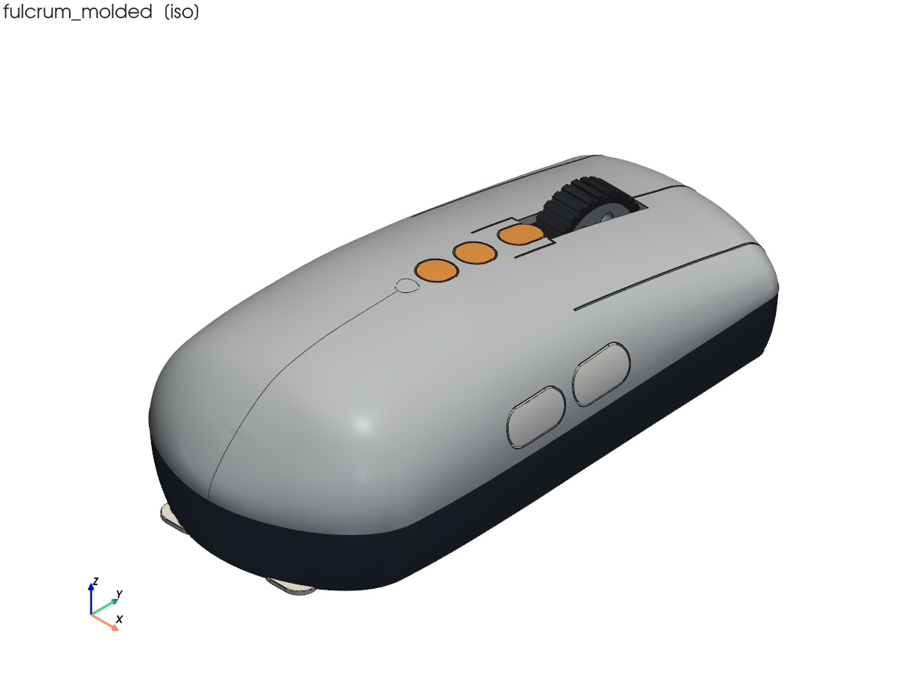
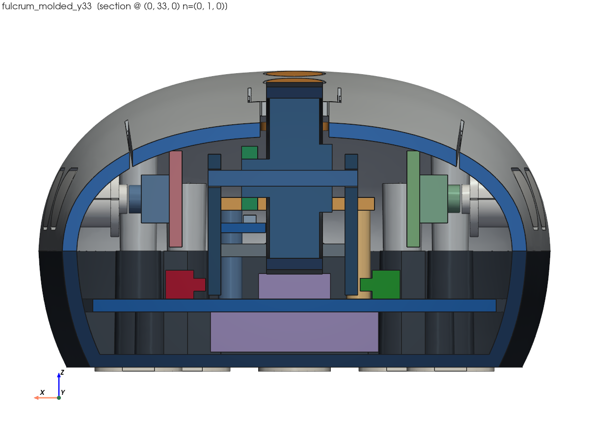
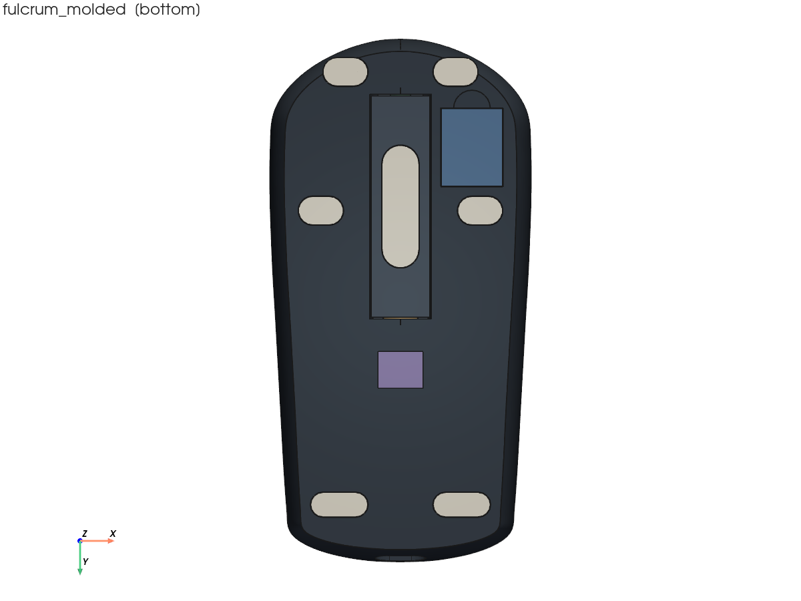
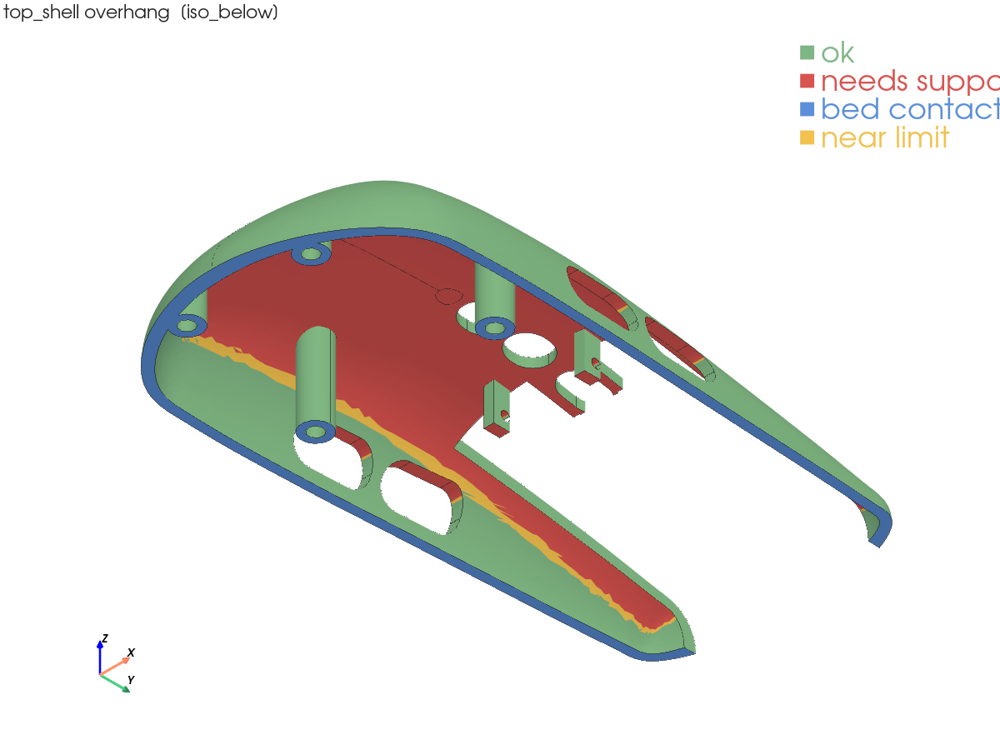

# cad: code-first parametric CAD

Parametric parts written in Python with [build123d](https://github.com/gumyr/build123d)
(OpenCascade), rendered headlessly to PNG, checked in code, exported as STEP
for review in FreeCAD, and sliced for a Bambu Lab X1C. Built as a demonstration
of an AI coding agent (Claude Opus 5.5 in Claude Code) doing real mechanical
design, end to end, from a terminal.

## Fulcrum: an ambidextrous wired/wireless mouse

| | |
|---|---|
|  |  |
| Moulded variant | Exploded: 53 parts (bought-in parts are envelopes) |
|  |  |
| Section x = 0: battery on its door, top board + DPI/mode posts, wheel, sensor, USB-C | Section through the wheel: cradle, ring magnet over Hall board, tilt switches, side buttons |
|  |  |
| FDM variant: separate main buttons on pivot pins | Underside: battery door, receiver garage, 7 skates, sensor window |
|  |  |
| Moulding check: base draft / undercut map | Printing check: top shell overhang map (X1C, 45°) |

An original design with gaming-mouse-level detail, and two variants built from
one parametric master:

| | `VARIANT=molded` | `VARIANT=fdm` |
|---|---|---|
| Intent | injection moulding (PC/ABS) | print on a Bambu Lab X1C |
| Walls | 1.8 mm, drafted 3° each side of the parting line | 2.0 mm |
| Main buttons | flexures moulded into the top shell | separate parts on 2 mm steel pivot pins |
| Fasteners | self-tapping M2 into moulded bosses | M2 heat-set inserts |
| Fits | 0.15 mm | 0.30 mm |

**Features**
- Symmetric pebble form (contour-lofted dome + rolled base), parting line at the
  widest silhouette so the base and top release from a two-plate tool.
- 12 inputs: left/right, wheel click + tilt left/right, wheel-mode toggle,
  DPI up/down, two side buttons on each flank.
- Scroll wheel with rubber tyre, optical encoder disc and ratchet detent ring,
  on a cradle that floats on the click and tilt switches.
- Wired (USB-C) and wireless: removable AA (NiMH, recharged over USB-C) under a
  hinged, latched door. Remove it for a lighter wired mouse, or fit an
  AA-size weight slug. Receiver garage on the underside.
- Optical sensor at the PixArt-standard 2.4 mm lens height, 7 PTFE skates (four
  hide the screws), power switch and connect button on the underside.

**Out of scope:** the PCB itself (boards, switches, sensor, battery and
connectors are modelled as placeholder envelopes, and parts are designed
around them), the ratchet spring and the mode-toggle latch.

**Verified in code** (`make test asm VARIANT=...`): every button post stops
exactly the specified pre-travel above its switch; the wheel stands 5 mm proud;
no part overlaps another except the declared contacts; moving parts keep their
running clearances; shell walls; mass and centre of gravity; FreeCAD reads the
STEP with the same volume and bounding box.

**Results** (both variants, from `make test asm`):

| | moulded | FDM |
|---|---|---|
| Size (L x W x H) | 128.0 x 64.0 x 37.5 mm | same |
| Parts | 53 | 57 (separate buttons + 2 pins) |
| Interference / clearance check | 0 overlaps, all clearances met (167 pairs) | 0 overlaps (213 pairs) |
| Button pre-travel (9 buttons) | 0.30 mm, every post | 0.40 mm, every post |
| Mass with NiMH AA, CoG | 109 g, (0.5, -4.0, 13.3) mm | 121 g, (0.5, -4.2, 13.5) mm |
| Shell walls (5th percentile) | top 1.55 mm, base 1.53 mm | top 1.81 mm |
| Draft (top shell / base) | outer faces >= 3°; undercuts 91 / 183 mm² (side-button openings, USB-C, nose tabs: side actions) | n/a |
| Print (X1C, Bambu PLA Basic, 0.20 mm) | n/a | 14 parts on one plate: 3 h 32 min, 72.9 g, supports under the dome |
| FreeCAD STEP round trip | pass (mesh volume within 0.05%, bbox exact) | pass |

**Known limitations / next steps:** the centre of gravity sits ~21 mm behind the
sensor with a battery fitted (it moves forward in wired mode with the battery
out); posts, bosses and internal walls carry only a 0.75° taper (internal
vertical walls are flagged no-draft); local thin spots (contact slots, latch
pockets) are under 2% of the base surface; the FDM top shell needs support
inside the dome; ergonomics are unverified until someone holds a print.

## Workspace

```
tools/      render.py check.py assembly.py mfg.py export.py slice.py roundtrip.py ...
projects/   bracket/ (smoke test)   fulcrum/ (the mouse)
CLAUDE.md   the working rules the agent follows
```

```bash
uv sync                                   # Python 3.14 venv with build123d etc.
tools/new_project.sh myproj && cd projects/myproj && make build render check
cd projects/fulcrum && make render exploded sections check VARIANT=molded
make print slice VARIANT=fdm              # Bambu Studio, X1C, Bambu PLA Basic
```

Rendering uses VTK offscreen through EGL (no display needed). Slicing uses
Bambu Studio's CLI with Bambu's own X1C/H2D presets. FreeCAD (AppImage)
reviews the STEP and checks the round trip.

## Licence

MIT (see [LICENSE](LICENSE)).
