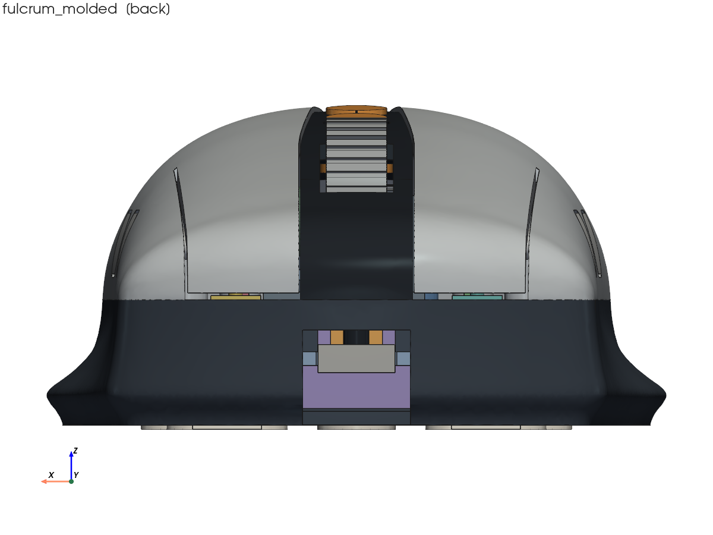
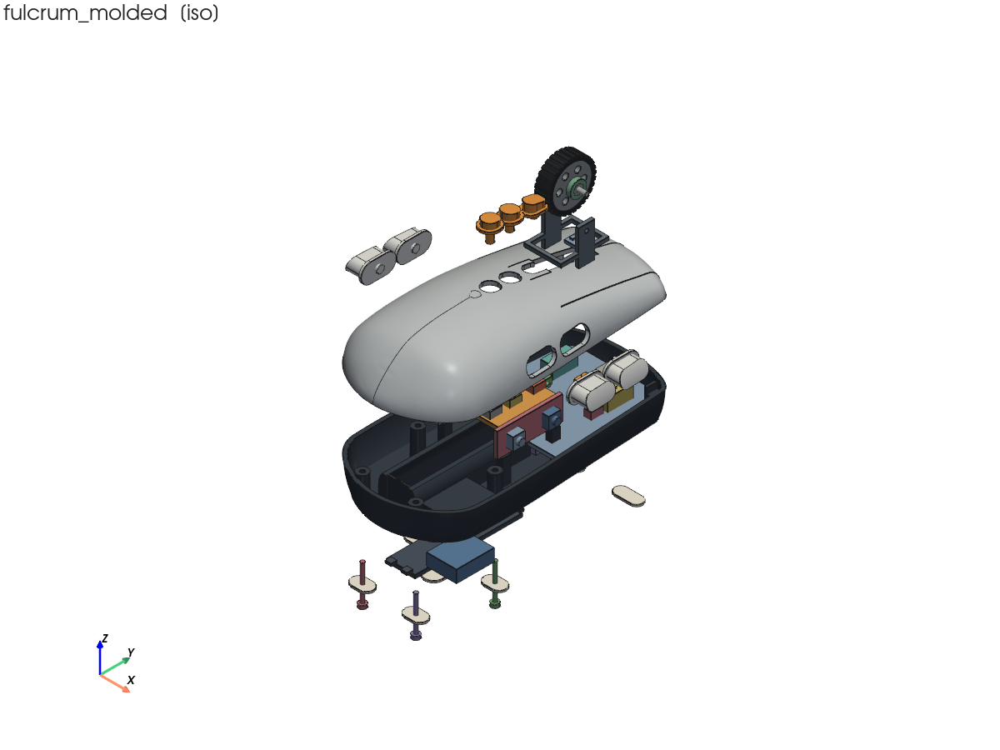
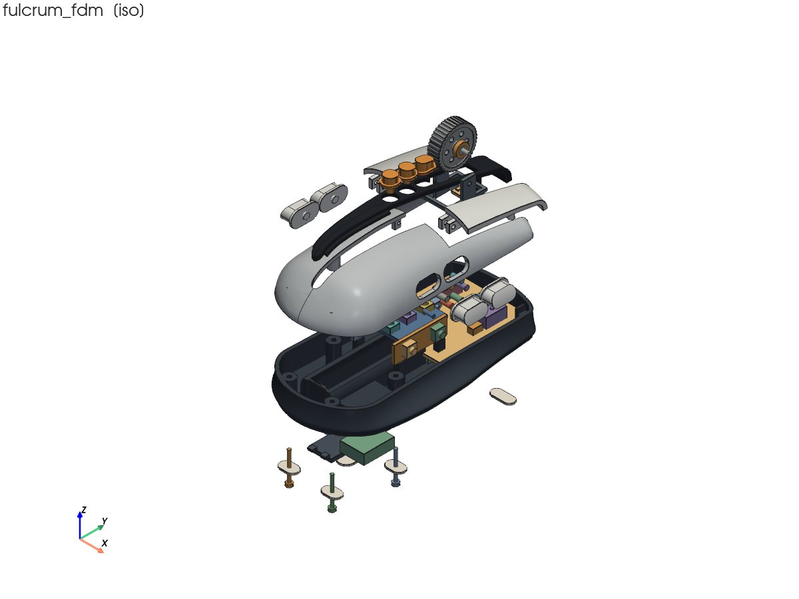
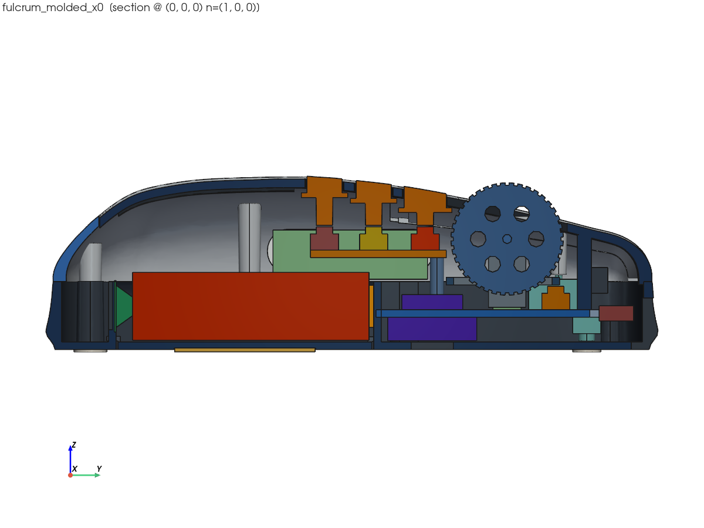
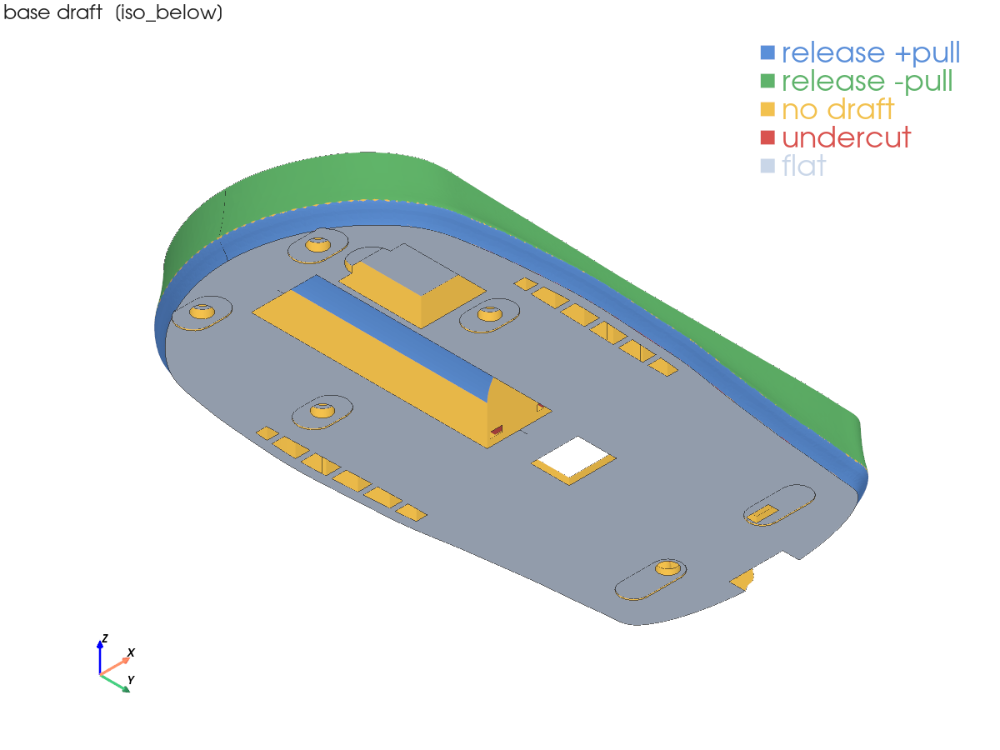

# cad: code-first parametric CAD

Parametric parts written in Python with [build123d](https://github.com/gumyr/build123d)
(OpenCascade), rendered headlessly to PNG, checked in code, exported as STEP
for review in FreeCAD, and sliced for a Bambu Lab X1C. Built as a demonstration
of an AI coding agent (Claude Opus 5.5 in Claude Code) doing real mechanical
design, end to end, from a terminal.

## Fulcrum: an ambidextrous wired/wireless mouse

| | |
|---|---|
|  |  |
| Moulded variant: pale dome, dark centre spine, metal wheel | Nose view: the black base flares like the foot of a bell curve into symmetric rests |
|  |  |
| Exploded, moulded (53 parts; bought-in parts are envelopes) | Exploded, FDM: separate pinned buttons, printed wheel with steel dowel weights |
|  |  |
| Section x = 0: battery on its door, top board + DPI/mode posts in the spine, wheel, sensor | Section through the grip: bell-foot rests, side buttons on their switches, battery channel |
|  |  |
| Underside: battery door, receiver garage, cored pockets under the rests, 7 skates | Moulding check: base draft / undercut map |

An original design with gaming-mouse-level detail, and two variants built from
one parametric master:

| | `VARIANT=molded` | `VARIANT=fdm` |
|---|---|---|
| Intent | injection moulding (PC/ABS) | print on a Bambu Lab X1C |
| Walls | 1.8 mm, drafted 3° each side of the parting line | 2.0 mm |
| Main buttons | flexures moulded into the top shell | separate parts on 2 mm steel pivot pins |
| Fasteners | self-tapping M2 into moulded bosses | M2 heat-set inserts |
| Fits | 0.15 mm | 0.30 mm |

**Features**
- Symmetric form: a pebble dome in the top shell, a dark centre spine (separate
  part) carrying the wheel, mode toggle and DPI buttons, and a black base that
  flares out like the foot of a bell curve into thin, wide rests on both
  sides (thumb rest in one hand, ring/pinky rest in the other).
- 12 inputs: left/right, wheel click + tilt left/right, wheel-mode toggle,
  DPI up/down, two side buttons on each flank.
- One-piece die-cast zinc scroll wheel (~16 g flywheel for free-spin, ratchet
  detent ring on the hub), magnetic encoder, on a cradle that floats on the
  click and tilt switches. FDM: printed wheel with six steel dowel weights.
- Wired (USB-C) and wireless: removable AA (NiMH, recharged over USB-C) under a
  hinged, latched door. Remove it for a lighter wired mouse, or fit an
  AA-size weight slug. Receiver garage on the underside. The cable plugs in
  and stays in while you use the mouse: the nose opening takes a 14 x 8 mm
  overmold (larger than USB-IF's recommended 12.35 x 6.5) with 0.5 mm all round.
- Optical sensor at the PixArt-standard 2.4 mm lens height, 7 PTFE skates (four
  hide the screws), power switch and connect button on the underside.
- Moulded base: the flare is cored from below by pockets with ribs (the
  cavity walls are straight so the core releases); FDM: solid flare.

**Out of scope:** the PCB itself (boards, switches, sensor, battery and
connectors are modelled as placeholder envelopes, and parts are designed
around them), the ratchet spring and the mode-toggle latch.

**Verified in code** (`make test asm VARIANT=...`): every button post stops
exactly the specified pre-travel above its switch; the wheel stands 5 mm proud;
an oversized USB-C plug and cable, fully seated, touch nothing and stay off the desk;
no part overlaps another except the declared contacts; moving parts keep their
running clearances; shell walls; mass and centre of gravity; FreeCAD reads the
STEP with the same volume and bounding box.

**Results** (both variants, from `make test asm`):

| | moulded | FDM |
|---|---|---|
| Size (L x W x H) | 130.7 x 71.9 x 37.5 mm (body 59 mm wide, rests included) | same |
| Parts | 53 | 63 (separate buttons, 2 pins, 6 wheel dowels) |
| Interference / clearance check | 0 overlaps, all clearances met (185 pairs) | 0 overlaps (254 pairs) |
| Button pre-travel (9 buttons) | 0.30 mm, every post | 0.40 mm, every post |
| Mass with NiMH AA, CoG | 129 g, CoG (0.4, -0.2, 13.6) mm, over the centre | <= 132 g (solid-plastic upper bound) |
| Draft / undercut (top shell, spine, base) | outer faces >= 3°; 101 / 17 / 260 mm² (side-button openings, USB notch, contact slots: side actions) | n/a |
| Print (X1C, Bambu PLA Basic, 0.20 mm) | n/a | one plate: 3 h 14 min, 70 g, supports under the dome and spine |
| FreeCAD STEP round trip | pass (mesh volume within 0.1%, bbox exact) | pass |

**Known limitations / next steps:** internal posts, bosses and walls carry
only a 0.75° taper or none (flagged as no-draft); the moulded base's lip zone
is ~3.7 mm thick locally; the FDM top shell and spine need supports; the
ratchet spring and mode-toggle latch are not modelled; ergonomics are
unverified until someone holds a print.

## Workspace

```
tools/      render.py check.py assembly.py mfg.py export.py slice.py roundtrip.py ...
projects/   bracket/ (smoke test)   fulcrum/ (the mouse)
CLAUDE.md   the working rules the agent follows
```

```bash
uv sync                                   # Python 3.14 venv with build123d etc.
tools/new_project.sh myproj && cd projects/myproj && make build render check
cd projects/fulcrum && make render exploded sections check VARIANT=molded
make print slice VARIANT=fdm              # Bambu Studio, X1C, Bambu PLA Basic
```

Rendering uses VTK offscreen through EGL (no display needed). Slicing uses
Bambu Studio's CLI with Bambu's own X1C/H2D presets. FreeCAD (AppImage)
reviews the STEP and checks the round trip.

## Licence

MIT (see [LICENSE](LICENSE)).
